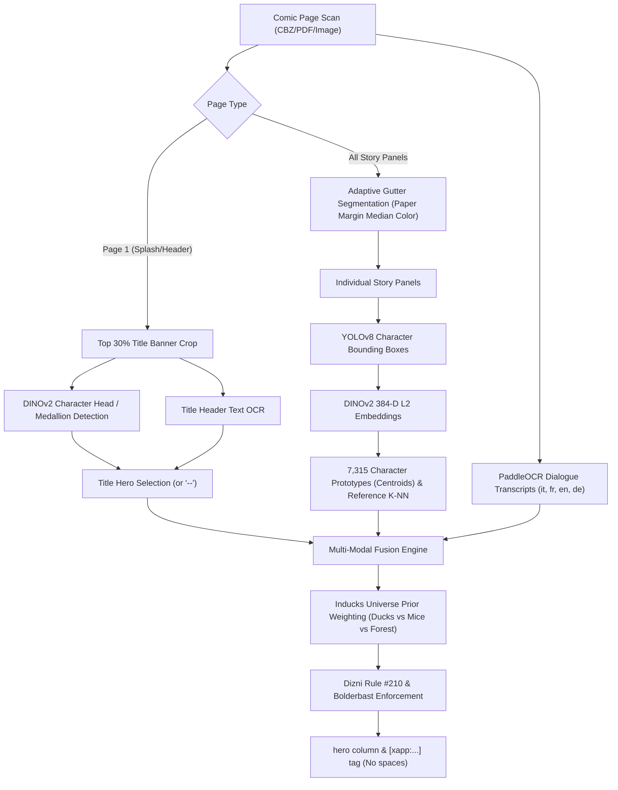

# 🎨 Disney Vision - Character Detection & Multi-Modal Recognition

A fast, lightweight, and reliable computer vision module for detecting and identifying Disney comic characters on scanned comic pages when the Inducks story code is not identified. 

Designed to seamlessly complement **`dbi-generator`** and **`Archiving-Helper`** while strictly adhering to **Bolderbast** and **Dizni** specifications.

---

## 🌟 Key Highlights & Architecture

The system operates on an advanced multi-modal fusion architecture combining deep metric learning, panel layout segmentation, and OCR dialogue analysis:



### 1. Title Hero (`hero` column) vs Appearances (`xapp`)
In accordance with Bolderbast standards:
* **The `hero` column**: Represents **strictly the hero printed in the title banner/logo** on page 1 (either as a title medallion/head illustration or explicit title text like `"DONALD DUCK dans..."`).
  * If no character appears in the title logo/text, the `hero` column is strictly set to **`"--"`** (e.g. an ensemble story or title like `"Tout vient à point..."`).
  * The hero is **never** guessed based on who speaks the most in dialogues.
* **The `[xapp:...]` tag (eXact Appearances)**:
  * Contains all Disney characters physically appearing across the panels of the story.
  * Formatted **strictly without spaces** between commas (e.g. `[xapp:DD,HDL,US]`).
  * Sorted alphabetically.
  * **Dizni Rule #210**: If a `hero` is defined (different from `"--"`), it is guaranteed to be present in `[xapp:...]`.

---

## 📚 Dataset & 7,315 Character Prototypes

* **Full Inducks Catalogue Indexed**: Built on the complete official Inducks dataset (`characterscans.dbp`), indexing **43,297 scans** across **7,315 distinct characters**.
* **Compact Storage**: Despite covering the entire Inducks universe, the vector index (`data/character_embeddings.npz`) weighs only **69.5 MB** on disk and loads into RAM in **< 2 seconds**.
* **Zero Network Dependency**: Runs 100% locally and offline on CPU (or GPU if available). Zero Wi-Fi or internet bandwidth required during recognition.

### Why Centroid Prototypes Solve Multi-Character Scans
In comic archives, contributors often upload scans where multiple characters appear in the same panel (for example, *Doc Finkelstein* and *Shrimp* sharing panel `at_mma1988_25p34_002`):
1. **Intruder Cancellation**: For secondary characters that occasionally appear alongside Donald Duck or Mickey Mouse, computing the normalized mean vector (L2-centroid prototype) mathematically cancels single-scan background intruders.
2. **Same Character Multiplicity**: When the same character appears multiple times on an image (or in collective entities like *Huey, Dewey and Louie* `HDL` or *The Beagle Boys* `BB`), the visual representation reinforces the character's feature cluster.
3. **Historical Styles & Costume Preservation**: No genuine historical variations (such as 1930s Gottfredson Mickey vs modern Casty/Cavazzano, Barks vs Don Rosa vs Italian masters, or superhero alter-egos like Fantomiald `PK`) are discarded.

---

## 📂 Project Structure

```
apps/vision/
├── data/
│   ├── character_embeddings.npz    # Compact index (43,297 vectors + 7,315 prototypes, 69.5 MB)
│   └── references/                 # Local store of Inducks reference portraits (ignored by Git)
├── download_character_references.py # Multi-threaded downloader from Inducks catalog (UTF-8 safe)
├── build_character_embeddings.py   # Extracts DINOv2 embeddings & builds centroid prototypes
├── search_character.py             # Instant character matcher with prototype regularization
├── page_character_detector.py      # Adaptive panel segmentation & living target detection
├── multimodal_character_fusion.py  # Fusion engine (Vision + Dialogue OCR + Universe priors)
├── dialogue_speaker_extractor.py   # Structured OCR, speech bubbles & speaker attribution engine
├── bridge.py                       # Interface bridge for dbi-generator & Archiving-Helper
├── visualizer.py                   # Visual debugger & annotator (panels, heroes, bounding boxes)
├── detect-characters.bat           # Drag & drop runner for comic archives and images
├── evaluate_inducks_accuracy.py    # Benchmark runner against Inducks human annotations
└── README.md                       # Documentation
```

---

## 🛠️ Usage Guide

### 1. Test Single Character Crop
Identify a cropped character face or torso against the 7,315 character prototypes:
```bash
python search_character.py "path/to/character_crop.png"
```

### 2. Analyze Full Comic Page
Segment panels, detect characters, and summarize visual appearances:
```bash
python page_character_detector.py "path/to/page.png"
```

### 3. Run Full Story Analysis (Multi-Modal Fusion)
Analyze an entire story from an archive (`.cbz`, `.cbr`, or `.pdf`) to determine `title_hero` and `[xapp:...]`:
```bash
python -c "
from bridge import detect_characters_from_archive_story
from archive_loader import LazyArchive

archive = LazyArchive('path/to/comic.cbz')
hero, xapp, stats = detect_characters_from_archive_story(archive, start_page=3, num_pages=10)
print('Hero:', hero)
print('XAPP:', stats['xapp_tag'])
"
```

### 4. Structured OCR & Dialogue Speaker Attribution
Extract panels, cluster text lines into speech bubbles, classify them without noise suppression, and attribute speakers by geometric proximity to detected characters:
```bash
python dialogue_speaker_extractor.py "path/to/page.jpg"
```
Produces a structured JSON document and a readable screenplay transcript:
```text
┌─── CASE #2 (Personnages : DD)
│   💬 [DD]           : « E VISTO CHE ABBIAMO INTA- SCATO UNO SPROPOSITO... »
│   💬 [DD]           : « VIVA MISTER GOOSE! »
└───
┌─── CASE #3 (Personnages : US)
│   💥 [EFFET SONORE]: *URRA!*
│   💥 [EFFET SONORE]: *SGURGLE!*
└───
```
Powers **Pipeline v2** in `apps/transcript` while maintaining full FTS5 search compatibility.

---

## 🔤 Character Encoding (UTF-8 Integrity)

All scripts feature native UTF-8 decoding and automatic mojibake repair routines (`heal_mojibake`). Character names with diacritics are always cleanly preserved:
* `Dó-Ré-Mi` (never `Dó-Ré-Mi`)
* `Tonhão` (never `Tonhão`)
* `Abílio` (never `Abílio`)
* `Acácio` (never `Acácio`)
